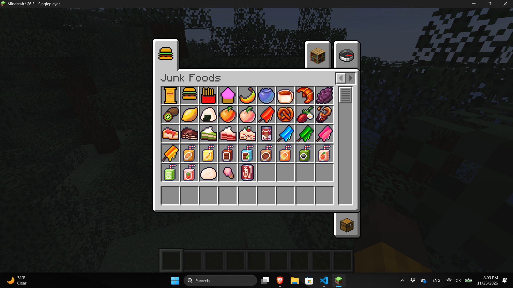
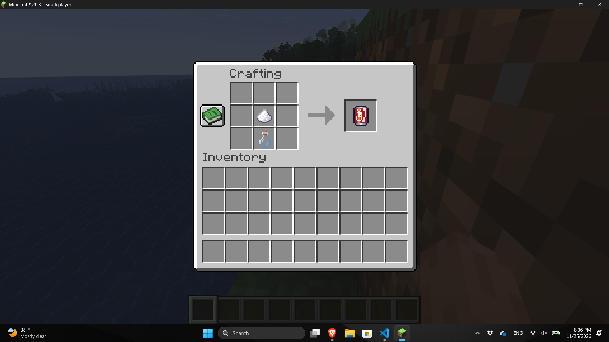

# The Junk Foods Addon

A Fabric mod for Minecraft 26.3 that adds 41 snacks, drinks and treats that include burgers, fries, boba, cakes, popsicles and soy milks, and much more!

## Features
- **41 new foods**, some textures I drew myself like the burger, chips, and fries but the others I got from an icon pack (link to that is below)
- **Its own "Junk Foods" Creative tab** with a burger icon (foods also appear in Food & Drinks)
- **Crafting recipes for every food**
- **Cool effects:**
  - **Soda:** sugar rush (Speed)
  - **Coffee:** caffeine energy (Haste)
  - **Ice cream and popsicles:** brain freeze (Slowness)
  - **Lemon:** so sour (Nausea)
- Real drinking animation for soda and coffee

## All Foods and their Categories
**Junk food** - Burger, Fries, Chips, Soda, Pretzel, Cheese
**Desserts** - Ice Cream, Cupcake, Popsicle (5 colors), Cheesecake, Chocolate Cake, Matcha Cake, Red Velvet Cake, Strawberry Cake
**Fruit** - Banana, Blueberry, Grape, Kiwi, Lemon, Orange, Peach, Strawberry (I know this is junk foods but you also gotta be healthy somtimes :)
**Drinks** - Coffee, Boba Tea, Matcha, Soy Milk (Almond, Banana, Chocolate, Choco Mint, Coffee, Mango, Peach, Strawberry and plain)
**Meals** - Onigiri, Croissant, Soup

## Example Recipes
- Here are examples for crafting some of the foods in this mod!
- Fries - 2 Baked Potatoes makes 3 Fries
- Burger - Bread, Cooked Beef or steak, Bread (stacked vertically)
- Soda - Sugar + Glass Bottle
- Banana - Apple + Yellow Dye
- Strawberry - Sweet Berries + Red Dye
- Cheesecake - Cake + Cheese
- Boba Tea | Milk Bucket + Sugar + Slimeball
- Soy Milk - Glass Bottle + 2 Wheat Seeds
- Blue Popsicle - Popsicle + Blue Dye

## How to Install
1. Install Fabric Loader for Minecraft
2. Download Fabric API and put it in your `mods` folder
3. Put `junkfoodsaddon-1.0.0.jar` in your `mods` folder
4. Launch Minecraft and open the Junk Foods Creative tab (Page 2 in Foods and Drinks tab) and get ready to eat more food in Minecraft :D

## Built With
- Java 25
- Fabric Loader and Fabric API
- Gradle
- Some of the textures were hand-drawn using Piskel, and the rest are from the [Free 100-Piece 16x16 Pixel Art Food Icons Pack](https://itch.io/t/4018426/free-100-piece-16x16-pixel-art-food-icons-pack)

## Credits
Made by Hitesh Vinothkumar (A 13 year old hack clubber) and this project was made for HackCraft!

## License
The code for this mod is available under the CC0 license, so feel free to learn from it. Some of the textures I drew are mine but the icon pack textures belong to their artist so follow that pack's license.
